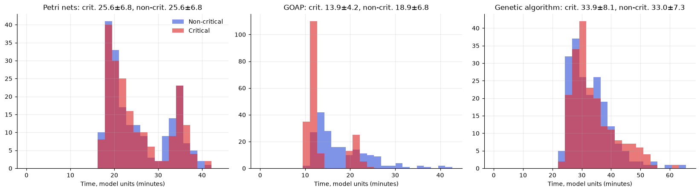

# Patient routing in an emergency department: open re-implementation

Open code for a re-implementation of the experiment described in:

> Bondarenko G. O., Popova A. R., Syryh A. S., Patoka Y. V., Geichenko E. I., Pavluk V. S.
> *Intelligent Patient Routing Models in Emergent Situations - An Integrative Approach to Optimizing Distribution.*
> 2025 XXVIII International Conference on Soft Computing and Measurements (SCM), pp. 174-177.
> DOI: [10.1109/SCM66446.2025.11060180](https://doi.org/10.1109/SCM66446.2025.11060180)

## What this repository is

The paper compares three routing policies for patients inside a hospital emergency department: Petri nets, GOAP (goal-oriented action planning) and a genetic algorithm.
The original experiment code of the paper was not preserved. This repository contains an **open re-implementation**:
the model is rebuilt from the description in the paper, and its free parameters are calibrated so that the means and standard deviations
of the waiting time match the values read from the figures of the paper.

The code is deterministic for a given seed, every number below can be reproduced with one command, and the limits of the comparison are listed explicitly.

## Results of the re-implementation

100 seeds (100-199), which were not used in the final parameter search (it used seeds 1-10). Time is in model units that are treated as minutes.
"Target" is the value read from the figure of the paper (mean ± SD).

| Method | Critical: model mean ± SD | Critical: target | Non-critical: model mean ± SD | Non-critical: target |
|---|---|---|---|---|
| Petri nets | 25.6 ± 6.8 | 25 ± 5.5 | 25.6 ± 6.8 | 25 ± 5.5 |
| GOAP | 13.9 ± 4.2 | 14 ± 6.2 | 18.9 ± 6.8 | 21 ± 6.5 |
| Genetic algorithm | 33.9 ± 8.1 | 44 ± 10.0 | 33.0 ± 7.3 | 31 ± 10.0 |



The histograms show a random sample of 200 patients per group (drawn with replacement from all 100 seeds, to match the sample size of the paper's figures). The means and SD in the table use all patients.

## Limits (read before citing)

- **Calibrated, not independent.** The model has 11 free parameters, calibrated against 12 summary statistics read from the figures (6 means, 6 SD), plus base parameters inherited from an earlier calibration. Agreement of the means after calibration is not independent confirmation of the paper.
- **Genetic algorithm, critical patients.** The paper shows critical patients waiting longer than non-critical ones under the genetic algorithm (about 44 vs 31). The model gives about 34 for both groups. This mismatch is not resolved.
- **Spread of GOAP.** The model SD for GOAP critical patients (4.2) is lower than the one read from the paper (6.2).
- **Not clinical data.** The model is a simulation. It contains no real patients, and no clinical conclusion follows from it.
- **Not the original code.** Numbers here describe this model, not the model that produced the paper.

## Run

```
pip install -r requirements.txt
python code/reproduce.py results
```

The script prints the table and writes `results/forms_model.png` and `results/results.md`.
`code/fit_v10.py` repeats the parameter search (`python fit_v10.py <seed> <n>`); `code/_v10.json` stores the parameters used above.
Code comments are partly in Russian.

## Files

- `code/reconstruct_v3.py` - corridor model of the emergency department.
- `code/fit_v3.py` - base calibration and model factory.
- `code/fit_v10.py` - the three policies (Petri nets, GOAP with planning delay, genetic algorithm) and the parameter search.
- `code/_v3_detour.json`, `code/_v10.json` - calibrated parameters.
- `code/reproduce.py` - reproduces the table and the figure on fresh seeds.
- `figures/forms_model.png`, `figures/results.md` - output of the last run.

The figures of the paper are not included. They belong to the publisher.
